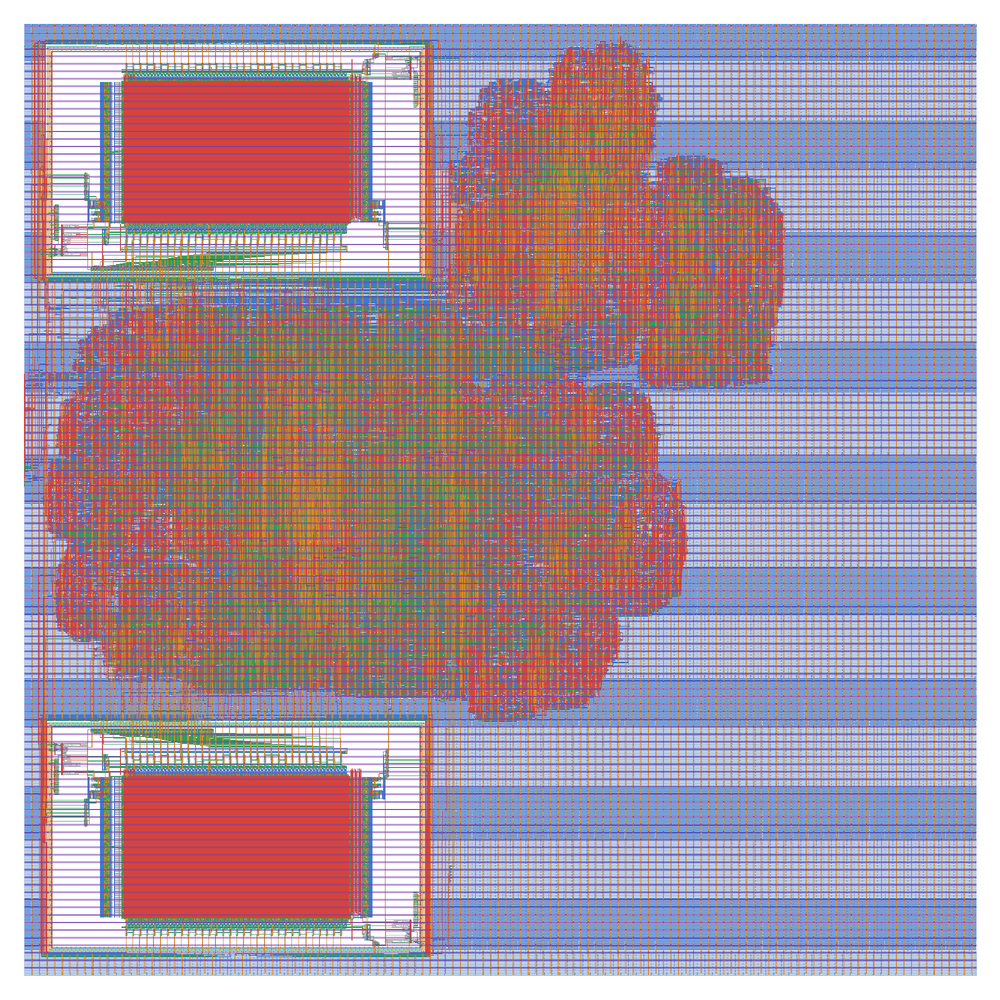
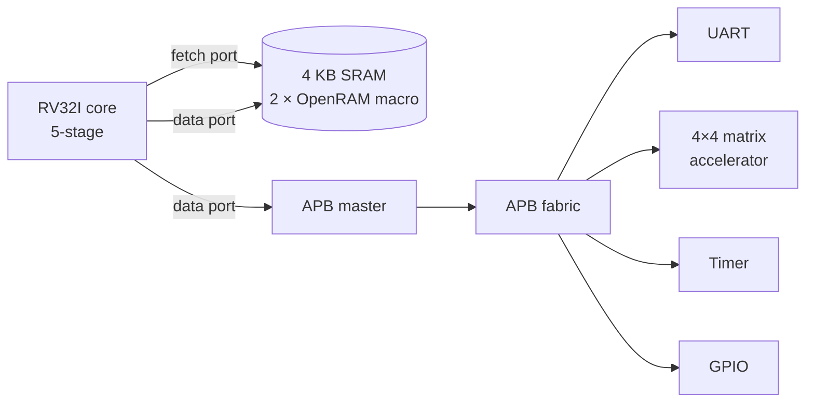

# rv32i-soc-asic

A 5-stage RV32I processor with a matrix-multiply accelerator, four APB peripherals and two
SRAM macros, driven by bare-metal C firmware and taken from RTL to GDSII on SkyWater 130 nm
with OpenROAD-flow-scripts — DRC- and LVS-clean, verified at RTL, gate and post-layout level.

`SystemVerilog` · `C` · `RISC-V` · `Yosys` · `OpenROAD` · `OpenSTA` · `Magic` · `Netgen` · `SKY130` · `Tcl` · `Python`

## Results

Sign-off run: SKY130HD, two `sky130_sram_2kbyte_1rw1r_32x512_8` macros (4 KB), 15 ns clock
target, typical corner (25 °C, 1.80 V).

| | |
|---|---|
| **Fmax** | 75.3 MHz for this run · 86.8 MHz best across the clock sweep |
| **Cell area** | 1.10 mm² (0.569 mm² of it the two SRAM macros) at 37.4 % utilization |
| **Power** | 37.7 mW · 23.4 mW (−38 %) in the clock-gated variant |
| **Cells / flops** | 43,519 / 5,105 (excluding fill and tap cells) |
| Setup WNS / TNS | +1.722 ns / 0 |
| Hold worst slack | +0.030 ns |
| Router DRC | 0 |
| **Magic sign-off DRC** | **0 errors** on the design, SRAM macros held as the PDK's abstract |
| **Netgen LVS** | **circuits match uniquely** — 43,039 devices, 52,041 nets, macros included |
| Post-layout simulation | PASS — functional and SDF back-annotated |
| **Accelerator speedup** | **10.7×** over software for a 4×4 multiply, measured on the SoC |
| Critical path | branch resolution to the SRAM fetch address, 37 cells |

Evidence for every number is in [`docs/reports/`](docs/reports/) and [`results/`](results/).
Details: [architecture](docs/architecture.md), [verification](docs/verification.md),
[implementation](docs/implementation.md) and [design decisions](docs/DECISIONS.md).



## Architecture



| Block | Implementation |
|---|---|
| Core | RV32I + Zicsr + Zicntr, machine mode; IF / ID / EX / MEM / WB |
| Hazards | MEM→EX and WB→EX forwarding, register-file bypass, 1-cycle load-use stall |
| Branches | resolved in EX, static not-taken, 2-cycle penalty |
| Front-end | decoupled fetch: two reads in flight, 3-entry instruction queue with a credit rule |
| Traps and interrupts | `ecall`, `ebreak`, `mret`, illegal instruction, misaligned access; timer, software and external interrupts; 64-bit cycle and instret counters |
| Memory | one unified 4 KB RAM, 1 read port (fetch) + 1 read/write port (data), at `0x8000_0000` |
| Bus | APB, 4 KB per slave: UART `0x4000_0000`, accelerator `0x4000_1000`, timer `0x4000_2000`, GPIO `0x4000_3000` |
| Accelerator | N = 4, DW = 32 matrix multiply, one result row per cycle ([matmul-accel-asic](https://github.com/Manas-Punjabi/matmul-accel-asic)), behind an APB register interface |
| Debug / verification port | RVFI retirement trace, simulation only |

RAM and the reset PC sit at `0x8000_0000`, Spike's defaults, so the same ELF runs unchanged
on the RTL and on the Spike reference simulator. Register maps and the C driver:
[`sw/soc.h`](sw/soc.h).

## Verification

| Check | Tool | Result |
|---|---|---|
| Lint, every block ± RVFI | Verilator 5.020 | clean |
| riscv-tests `rv32ui` + `rv32mi` | Icarus 12.0 | 55 / 55, on the core and on the full SoC |
| Directed tests | Icarus | interrupts (priority, masking, exact `mepc`) and `fence.i` |
| Random memory stalls | Icarus | every ISA test re-run with a randomly stalling data port |
| Peripheral testbenches | Icarus | 554 checks: accelerator, UART (±2 % baud error), timer, GPIO |
| Flop vs SRAM memory model | Icarus | 6,195 checks on both ports, against a reference model |
| Mutation testing | `scripts/mutate_*.sh` | 28 / 28 core, 12 / 12 peripheral, 6 / 6 synchronizer bugs caught |
| CDC | structural check on the netlist | all 9 asynchronous inputs 2-flop synchronized, reset synchronizer verified |
| Logic equivalence | Yosys | 12 / 14 modules proven, 0 mismatches |
| Post-layout simulation, functional | Icarus + SKY130 models | PASS |
| Post-layout simulation, SDF | + OpenSTA SDF | PASS at 15 and 8 ns; fails at 5 ns as a control |
| Lockstep co-simulation | [rv32i-soc-validation](https://github.com/Manas-Punjabi/rv32i-soc-validation) | every retired instruction matches a Spike-validated reference model over 319 programs |

Mutation testing measures whether the tests detect defects rather than merely passing: each
injected bug is a deliberate change to the RTL that the suite must catch. The 5 ns SDF run is
a control in the same spirit — a timing-annotated run that passes at every period is not
applying timing.

## Design studies

### The accelerator is bus-bound

Bare-metal C on the SoC, N = 4, DW = 32, timed with the on-chip timer, mean of 16 multiplies,
both results checked identical:

| cycles per 4×4 multiply | |
|---|---|
| software (no M extension, libgcc multiply) | 5,075 |
| accelerator — load 285, compute and poll 13, read 175 | **473** |
| speedup | **10.7×** |
| time spent moving data over the bus | **97.2 %** |

The multiply itself takes 8 cycles; the rest is 48 single-word APB transfers. A faster
multiplier would change almost nothing — DMA or a wider port is what moves this number.

### A synchronous SRAM costs a pipeline stage

The SRAM macro latches its address on the rising edge, drives data from the falling edge,
and cannot hold its output. The read is therefore its own pipeline stage, so the core gained
a decoupled fetch front-end that keeps straight-line code at one instruction per cycle. Taken
branches went from 1 to 2 cycles and loads gained one wait state; the benchmark speedup was
unchanged because both paths slowed alike.

### PPA sweep


| target | WNS | Fmax | cell area | power | DRC |
|---|---|---|---|---|---|
| **12 ns** | +0.474 ns | **86.8 MHz** | 1.103 mm² | 47.1 mW | 0 |
| 13 ns | +0.558 ns | 80.4 MHz | 1.103 mm² | 43.6 mW | 0 |
| 15 ns | +1.722 ns | 75.3 MHz | 1.103 mm² | 37.7 mW | 0 |
| 20 ns | +4.971 ns | 66.5 MHz | 1.104 mm² | 28.8 mW | 0 (hold −0.025 ns) |

Area stays within 0.1 % across the range because the two macros dominate the die. Power
scales with frequency, 47 → 29 mW.

### Clock gating and scan, measured post-route

| | Result |
|---|---|
| Clock gating (78 clock gates) | power **−38 %** (37.7 → 23.4 mW), area −2.1 %, but a −0.043 ns hold violation |
| Scan insertion | 26 chains, **100 %** of 5,186 flops; routed at **+3.6 % area, +13.4 % wirelength**, 0 DRC |

Clock gating has to come first: this cell library has no scan flop with an enable, so without
it scan coverage stops at 38 %. Data: [`results/variants.csv`](results/variants.csv).

## Reproduce

```bash
# RTL-level checks (lint, testbenches, ISA tests, benchmark); needs RISC-V GCC and
# riscv-tests, see docs/verification.md
make verify
make bench

# RTL to GDSII in the ORFS container, then sign-off
make asic FLOW_VARIANT=base
make sta  FLOW_VARIANT=base     # three corners
make drc  FLOW_VARIANT=base
make lvs  FLOW_VARIANT=base
make gls-sdf FLOW_VARIANT=base

# PPA sweep and plot
make sweep
```

| Tool | Version |
|---|---|
| Verilator / Icarus Verilog | 5.020 / 12.0 |
| Yosys | 0.33 local, 0.68 in the ORFS image |
| OpenROAD-flow-scripts | `openroad/orfs@sha256:69bcb470…` (OpenROAD 26Q3-2276) |
| Magic / Netgen | 8.3.683 / 1.5.323, built from source |
| RISC-V GCC | 13.2.0, `rv32i/ilp32` |
| SKY130 PDK | sky130A via volare |

The sign-off run takes about 30 minutes and peaks at 4.6 GB.

## Repository layout

```
rtl/        core/ (pipeline, fetch, decode, ALU, CSR, register file), accel/, bus/,
            periph/ (UART, timer, GPIO), mem/, soc_top.sv
tb/         core, SoC, memory and peripheral testbenches; asm/ directed tests
sw/         crt0, linker script, memory map, benchmark firmware
flow/       ORFS design config, SDC, PDN script for the SRAM macros
scripts/    mutation tests, CDC, LEC, clock gating, scan, STA, DRC, LVS, GLS, sweep
docs/       architecture, verification, implementation, design decisions; reports/
results/    clock sweep and variant comparison data
```

## Known limitations

- **Single-corner closure.** The sky130hd platform optimizes at the typical corner only; ss
  setup and ff hold are measured and fail. Multi-corner optimization is blocked by the SRAM
  macro's own liberty, which demands an input slew no cell in the library can drive.
- **The SRAM macro ships only a typical-corner liberty**, so ss and ff timing is approximate
  on paths through it.
- **Scan is routed as its own variant**, outside the sign-off run: the flow has no DFT step.
- **Clock gating adds a small hold violation** (−0.043 ns), so the ungated run is the
  sign-off variant.
- **Macro placement is automatic**, so Fmax varies from run to run; the sweep is the
  reliable picture, not any single point.
- **Two modules are not formally proven equivalent** (`mm_pe`: multiplier SAT blow-up;
  `apb_uart`: non-inductive invariant); both are covered by simulation.

## License

MIT
