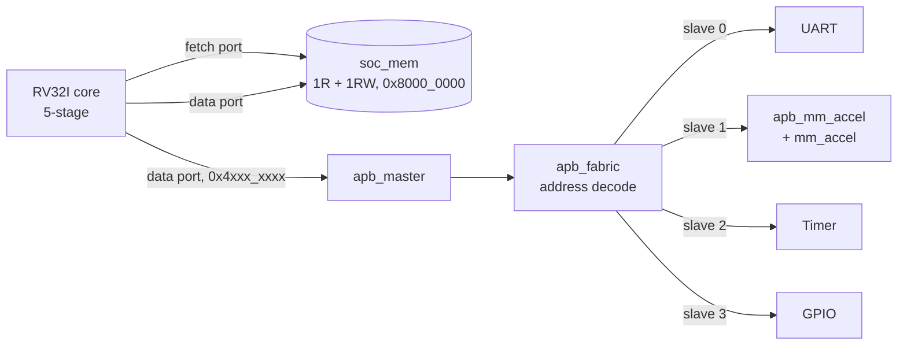

# Architecture

`soc_top` is a 5-stage RV32I processor with a matrix-multiply accelerator attached as a
memory-mapped APB peripheral, three further peripherals, 4 KB of SRAM built from two OpenRAM
macros, and bare-metal C firmware. This document describes the hardware and its interfaces.
[verification.md](verification.md) covers how each block is checked,
[implementation.md](implementation.md) the physical design, and [DECISIONS.md](DECISIONS.md)
the reasoning behind each design choice.

**Why APB, not AXI-Lite.** The accelerator needs 32 writes and 16 reads per 4×4 multiply:
about 96 bus cycles around 8 cycles of compute. AXI-Lite is also single-transfer, so it would
not change that ratio; only bursts or DMA would. APB costs a fraction of the RTL and
verification effort, and the bus-overhead measurement is the more interesting result. An
AXI-Lite-to-APB bridge is how an AXI-Lite port would be added later, as in most SoCs.

## Memory map

| Window | What | Notes |
|---|---|---|
| `0x8000_0000` up | `soc_mem`, 1024 words (4 KB) | one unified memory: 1 read port (fetch) + 1 read/write port (data). Aliased across `0x8xxx_xxxx`. |
| `0x4000_0000` up | APB, 4 KB per slave | one APB transfer per access through `apb_master` |
| elsewhere | — | reads return 0, writes are dropped, no trap |

| Base | Slave | Contents |
|---|---|---|
| `0x4000_0000` | 0 | UART |
| `0x4000_1000` | 1 | Matrix accelerator |
| `0x4000_2000` | 2 | Timer |
| `0x4000_3000` | 3 | GPIO |

`apb_fabric` decodes `PADDR[19:12]`. An access outside the mapped slaves returns `PSLVERR` in
one cycle rather than hanging. RAM and the reset PC sit at `0x8000_0000`, Spike's defaults, so
the same ELF runs on the RTL and on an instruction-set simulator. `sw/soc.h` is the C view of
these tables; keep the two in sync.

### Accelerator (slave 1)

| Offset | Name | Access | Bits |
|---|---|---|---|
| `0x000` | CTRL | W | bit0 = start (ignored while busy) |
| `0x004` | STATUS | R | bit0 = busy, bit1 = done (sticky) |
| | | W | bit1 = 1 clears done |
| `0x008` | PARAMS | R | `[7:0]` = N, `[15:8]` = DW |
| `0x400` | A[0..N²-1] | W | row-major operand A |
| `0x800` | B[0..N²-1] | W | row-major operand B |
| `0xC00` | C[0..N²-1] | R | result |

Misaligned or out-of-range matrix accesses return `PSLVERR`. The accelerator itself is the
unchanged RTL of [matmul-accel-asic](https://github.com/Manas-Punjabi/matmul-accel-asic):
N = 4, DW = 32, one result row per cycle.

### UART (slave 0): 8N1, `baud = clk / DIV`

| Offset | Name | Access | Bits |
|---|---|---|---|
| `0x000` | TXDATA | W | `[7:0]` byte; accepted only when `tx_ready`, else dropped |
| `0x004` | RXDATA | R | `[7:0]` byte; the read pops it |
| `0x008` | STATUS | R | bit0 `tx_ready`, bit1 `tx_idle`, bit2 `rx_valid`, bit3 `rx_overrun` (sticky), bit4 `rx_frame` (sticky) |
| | | W | bit3 / bit4 = 1 clears the sticky flag |
| `0x00C` | CTRL | RW | bit0 `rx_ie`, bit1 `tx_ie` |
| `0x010` | DIV | RW | `[15:0]` clocks per bit, minimum 4; reset value is the `DIV_RESET` parameter |

TX is double-buffered (holding register + shifter), so back-to-back bytes have no gap. RX
starts on the synchronized falling edge, re-checks the start bit at mid-bit (rejecting glitches
shorter than half a bit), and samples data and stop bits at mid-bit. On overrun the byte
already waiting is kept and the new one dropped.
`irq = (rx_valid & rx_ie) | (tx_ready & tx_ie)`.

### Timer (slave 2): CLINT-style

| Offset | Name | Access | Bits |
|---|---|---|---|
| `0x000` | MTIME_LO | RW | free-running 64-bit counter, +1 per clock |
| `0x004` | MTIME_HI | RW | |
| `0x008` | MTIMECMP_LO | RW | `irq_timer = (mtime >= mtimecmp)`; resets to all ones |
| `0x00C` | MTIMECMP_HI | RW | |
| `0x010` | MSIP | RW | bit0 = `irq_soft` |

Race-free compare update on a 32-bit bus: write HI = all ones, then LO, then the real HI.

### GPIO (slave 3): 8 outputs, 8 inputs

| Offset | Name | Access | Bits |
|---|---|---|---|
| `0x000` | OUT | RW | output pins |
| `0x004` | IN | R | input pins after a 2-flop synchronizer (2 clocks of latency) |
| `0x008` | SET | W | `OUT \|= data` |
| `0x00C` | CLR | W | `OUT &= ~data` |

**Interrupts.** Timer → `irq_timer`, MSIP → `irq_soft`, UART → `irq_ext`, through plain wiring;
there is no PLIC.

**Clocking.** One clock domain. The UART divides the system clock rather than using a separate
baud clock. The asynchronous inputs (UART RX and the GPIO inputs) pass through 2-flop
synchronizers, and the reset has a synchronizer of its own (asynchronous assert, 2-flop
release). Those are the SoC's only clock-domain crossings.

**Bus limitations.** `PSLVERR` from a slave is not turned into a bus-error exception; a byte or
half-word store to a peripheral arrives as the full lane-replicated word (APB3 has no `PSTRB`,
so the register maps are word-only); fetching from the APB window is unsupported.

## The core

`rtl/core/`: `rv32i_core.sv` (pipeline, hazards, forwarding, exceptions), `rv32i_fetch.sv`
(decoupled front-end), `rv32i_decode.sv`, `rv32i_alu.sv`, `rv32i_regfile.sv`,
`rv32i_csr.sv`. Hazard and forwarding logic is about 20 lines each and sits in the core file
next to the pipeline registers it controls.

| Feature | Implementation |
|---|---|
| ISA | RV32I + Zicsr + Zicntr, machine mode only, `misa` = RV32I |
| Pipeline | IF, ID, EX, MEM, WB |
| Forwarding | MEM→EX and WB→EX, plus WB→ID bypass inside the register file |
| Stalls | load-use (1 bubble); data port not ready (the whole pipeline freezes) |
| Branches | resolved in EX, static not-taken, 2 bubbles on a taken branch (the SRAM read is its own pipeline stage, see below) |
| Traps and interrupts | `mstatus` MIE/MPIE, `mtvec` direct, `mepc`, `mcause`, `mtval`, `mscratch`, `mie`/`mip` for timer, software and external interrupts; `ecall`, `ebreak`, `mret`, illegal instruction, misaligned load/store/fetch |
| Counters | `mcycle`/`minstret`, 64-bit, with `mcountinhibit` |
| Not implemented | hardware misaligned access (traps instead, which is spec-legal), vectored `mtvec`, S/U modes, PMP, `time`, triggers, bus-error exceptions |

Machine-mode traps are part of the core because the ISA test suites need them: every program
writes `mtvec`/`mstatus`/`mepc`, deliberately touches CSRs that must not exist (expecting an
illegal-instruction trap) and ends with `ecall`. The machine-mode subset is about 150 lines of
RTL.

Generic synthesis of the core alone (Yosys 0.33, simple gates): 9,298 cells and 1,654 flops,
992 of them the register file.

## Memory and the fetch front-end

The RAM is one memory with two ports: a read port for instruction fetch and a read/write port
for data. That shape lets every riscv-tests program and any Spike-linked ELF run on the SoC
unchanged, makes `fence.i` meaningful, and matches the PDK's
`sky130_sram_2kbyte_1rw1r_32x512_8` macro exactly. Two macros give 4 KB. Built from flops the
same memory would cost about 37k generic cells per KB, more than the rest of the SoC.

**A synchronous SRAM costs a pipeline stage.** The macro captures its inputs on the rising
edge but launches `dout` from the falling edge (`timing_type : falling_edge`, 0.383–0.529 ns),
so data is valid only from mid-cycle until the next rising edge. Its output cannot be held by
deasserting chip-select either: the OpenRAM model drives `dout` to X on every rising edge, and
the liberty has no cross-cycle hold arc. Every beat must be captured in the cycle it is valid.

| | flop memory | SRAM macro |
|---|---|---|
| instruction latency | address N → data N+1 | address N → data **N+2** |
| taken-branch penalty | 1 bubble | **2 bubbles** |
| load/store | 1 cycle | **+1 wait state** |

`rv32i_fetch.sv` is therefore a decoupled front-end: it issues reads, tracks the two in flight
and buffers landed instructions in a 3-entry queue with a credit rule, so straight-line code
still sustains one instruction per cycle and a back-end stall never loses a beat. The data port
needed no core change: its `ready` handshake absorbs the wait state. `soc_mem` models the
macro's timing even when built from flops, so one core is verified against the timing it gets
in silicon and the flop and macro builds stay interchangeable.

Because the front-end reads ahead, `fence.i` redirects to pc+4 and flushes it; if a store is
still in MEM, the `fence.i` is replayed instead, since that store writes memory on the same
edge the refetch would read.

## Firmware

`sw/crt0.S` zeroes x1–x31 (the register file has no reset), sets up the stack, clears `.bss`,
installs a trap handler that exits with `0x100 | mcause`, runs `main` and ends the simulation
the HTIF way: `tohost = (ret << 1) | 1`, so 0 is a pass. `sw/link.ld` places one RAM region at
`0x8000_0000` with `.tohost` 64-byte aligned and a 4 KB stack. `scripts/build_fw.sh` builds
with `-march=rv32i_zicsr -mabi=ilp32 -nostdlib -lgcc` (libgcc supplies `__mulsi3`).

### The accelerator benchmark

`sw/main.c` multiplies the same 4×4 matrices in software and on the accelerator, times both
with the timer's `mtime` (timer-read overhead subtracted, mean of 16 multiplies) and checks
the results element by element.

| cycles per 4×4 multiply | |
|---|---|
| software (`soft_matmul`) | 5,075 |
| accelerator: load 285, compute and poll 13, read 175 | **473** |
| speedup | **10.7×** |
| share of the accelerated path spent moving data over the bus | **97.2 %** |

The accelerator finishes its multiply in 8 cycles (N + LAT + 1) and spends the rest of the
time waiting for operands to arrive one APB word at a time. A faster multiplier would change
almost nothing; DMA or a wider port is what moves this number.

Two caveats, also printed by the firmware itself:

1. The core has **no M extension**, so every `*` in `soft_matmul` is a libgcc `__mulsi3`
   shift-and-add loop. The 10.7× is against software multiplication; a core with `mul` would
   close much of that gap and leave the 97.2 % bus share untouched.
2. Polling `STATUS` is itself bus traffic, so it is timed as its own phase rather than folded
   into compute; otherwise the data-movement share would be understated.

The SRAM's extra pipeline stage slowed both paths alike: with single-cycle flop memory the
same benchmark measured 4,125 and 383 cycles, also 10.7×, with a 95.3 % bus share.

## Co-simulation interface

The SoC is built to run in lockstep against an instruction-set simulator:
[rv32i-soc-validation](https://github.com/Manas-Punjabi/rv32i-soc-validation) compares every
retired instruction with a Spike-validated reference model. The core side of that contract:

- **RVFI retirement trace** under `` `ifdef RVFI ``, from WB: `rvfi_valid`, `order`, `insn`,
  `trap`, `pc_rdata`, `pc_wdata`, `rd_addr`, `rd_wdata` (0 when `rd_addr` = 0), `mem_addr`
  (word-aligned, byte lanes in the masks), `mem_rmask`, `mem_wmask`, `mem_rdata`,
  `mem_wdata`, plus `rvfi_intr`, `rvfi_ext_mcause` and `rvfi_ext_mip` for taken interrupts. At
  most one record per cycle, in program order; bubbles, stalls and flushed instructions never
  assert `valid`. An instruction that raises an exception is reported with `trap` = 1 and
  `pc_wdata` = `mtvec`; an instruction pre-empted by an interrupt is not reported, because it
  did not execute and is re-fetched after `mret`. `soc_top` exposes the bundle as top-level
  ports. None of it is synthesized.
- **Spike's memory map and test convention:** reset PC and RAM at `0x8000_0000`, peripherals
  in `0x4000_0000`–`0x4FFF_FFFF` treated as MMIO, and termination by storing
  `(code << 1) | 1` to `tohost` in its own 64-byte-aligned section.
- **Verilator-clean RTL:** no `#` delays, no reliance on X or Z, no `initial` except
  `$readmemh`, synchronous reset release.
- **Spike runs as `--isa=rv32i_zicsr_zicntr_zifencei --priv=M`.** The core is a superset of
  RV32I, which does not break lockstep as long as firmware on the compared path never reads
  `cycle`/`instret` (Spike's counters advance differently) and keeps interrupts disabled (the
  timer is not Spike's CLINT). The benchmark therefore times itself with `mtime`, whose reads
  the harness injects into the reference model.
