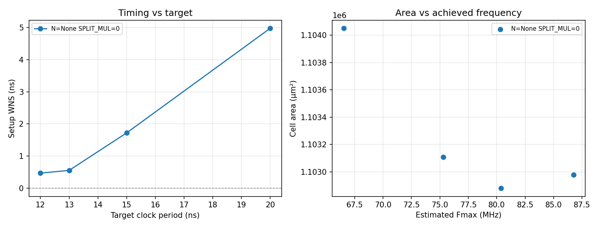

# Implementation

RTL to GDSII on SKY130HD with OpenROAD-flow-scripts (ORFS), the open-source flow built on
OpenROAD and Yosys, followed by standalone static timing analysis at three corners and
physical verification with Magic and Netgen. The sign-off run is the `base` variant: two SRAM
macros (4 KB), 15 ns clock target, `CORE_UTILIZATION=35`, run 2026-10-07. Every number below
comes from one flow setup; changing the excluded-cell list, repair margins, utilization or
corner setup re-maps the whole design, so numbers from two setups are never placed in one
table.

## Sign-off summary

Typical corner (25 °C, 1.80 V).

| Check | Result | Evidence |
|---|---|---|
| Setup WNS / TNS | +1.722 ns / 0 | [base_metrics.txt](reports/base_metrics.txt) |
| Hold worst slack | +0.030 ns | [base_metrics.txt](reports/base_metrics.txt) |
| Minimum period | 13.28 ns (75.3 MHz) | [`../results/sweep.csv`](../results/sweep.csv), 15 ns row |
| Cell area / utilization | 1,103,110 µm² (569,077 µm² of it the two macros) / 37.4 % | [base_metrics.txt](reports/base_metrics.txt) |
| Power | 37.7 mW | [base_metrics.txt](reports/base_metrics.txt) |
| Cells / flops | 43,519 / 5,105, excluding fill and tap cells | [base_metrics.txt](reports/base_metrics.txt) |
| Router DRC | 0 | [base_metrics.txt](reports/base_metrics.txt) |
| Magic DRC, full deck | 0 errors on this design, macros held as the PDK's abstract | [magic_drc_base.txt](reports/magic_drc_base.txt) |
| Netgen LVS | circuits match uniquely: 43,039 devices, 52,041 nets, macros included | [netgen_lvs_base.txt](reports/netgen_lvs_base.txt) |
| Post-layout simulation | pass, functional and with SDF delays | [verification.md](verification.md#post-layout-simulation) |
| Critical path | 37 cells: write-back register → forwarding → branch compare → redirect → instruction address → SRAM `addr1` | [sta_base_tt.txt](reports/sta_base_tt.txt) |

## Running the flow

ORFS runs in its Docker image. `scripts/orfs.sh` wraps the container: the image is pinned by
digest, the repository is mounted at `/work`, outputs go to `$ORFS_WORK` (default
`~/ASIC/rv32i-soc-asic-work`) mounted at `/orfs_work`, and the volare SKY130 PDK is mounted
read-only at `/pdk`, because the flow image's platform files include no SRAM macros.

```bash
make asic    FLOW_VARIANT=base   # RTL to GDSII, about 30 minutes, 4.6 GB peak
make report  FLOW_VARIANT=base   # timing, area, power summary
make sta     FLOW_VARIANT=base   # standalone STA at three corners
make drc     FLOW_VARIANT=base   # Magic full-deck DRC, macros abstracted
make lvs     FLOW_VARIANT=base   # Magic extraction + Netgen compare
make gls-sdf FLOW_VARIANT=base   # post-layout simulation with delays, plus the 5 ns control
make sweep                       # PPA across 12, 13, 15 and 20 ns
```

| Step | Runs on | Needs |
|---|---|---|
| `make verify`, `make bench` | host | Icarus Verilog 12.0, Verilator 5.020, RISC-V GCC 13.2, riscv-tests |
| `make asic`, `report`, `sta`, `sweep`, `clock-gate`, `dft` | ORFS Docker image | Docker, the SKY130 PDK via volare |
| `make drc`, `make lvs`, `make gls`, `make gls-sdf` | host | Magic 8.3.683 and Netgen 1.5.323 (source builds), the SKY130 PDK |

`make asic` forwards a flow setting only when it is set on the command line or in the
environment, so `flow/config.mk`'s own defaults (1024 words of memory, SRAM macros on) apply
otherwise.

### Flow settings

The excluded-cell list and the 20 % slew and capacitance repair margins in `flow/config.mk`
are carried over from matmul-accel-asic, where both were measured: two standard cells fail
Magic's `licon.8a` rule inside their own layouts, and the margins make the pre-route repair aim
below the limits that routed nets otherwise exceed. They are SKY130HD-wide findings, not
design-specific ones.

### SRAM macro integration

- **Power.** The OpenRAM macros name their supplies `vccd1`/`vssd1`, which the sky130hd
  platform's global connections do not cover. Without a fix the macros get no power and the
  power-grid step fails with `[ERROR PDN-0217] No grid found with name: CORE_macro_grid_1`, an
  error that names the grid rather than the missing connection behind it. `flow/pdn.tcl` is the
  platform script plus two `add_global_connection` lines.
- **Halo and channel.** `MACRO_PLACE_HALO` and `MACRO_PLACE_CHANNEL` keep standard cells and
  routing off the macros; the macro placer chooses their positions.
- **Pin alignment.** The macro pins do not sit on the routing tracks (`[WARNING MPL-0002]`: 8
  of 106 pins aligned on one macro, 2 of 106 on the other). Routing closes with 0 DRC, but it is
  a hazard for any route-limited variant.

## Static timing at three corners

`make sta` runs OpenSTA on the routed netlist and its extracted parasitics.

| Corner | Setup | Hold | Report |
|---|---|---|---|
| **tt** (cells and macro at TT) | 0 violations, WNS +1.80 ns | 0 violations, +0.030 ns | [sta_base_tt.txt](reports/sta_base_tt.txt) |
| **ss** (cells ss_100C_1v60, macro TT) | **943 violating endpoints**, WNS **−10.29 ns** | 0 violations, +0.34 ns | [sta_base_ss.txt](reports/sta_base_ss.txt), [census](reports/sta_base_ss_census.txt) |
| **ff** (cells ff_n40C_1v95, macro TT) | 0 violations, +5.20 ns | **256 violating endpoints**, worst **−0.078 ns** | [sta_base_ff.txt](reports/sta_base_ff.txt), [census](reports/sta_base_ff_census.txt) |

The standalone typical-corner slack (+1.80 ns) differs from the flow's own +1.722 ns on the
same path by 0.08 ns of arrival time: the standalone script reads the PDK libraries and the
parasitics directly.

**The design closes at tt and fails at the other two corners.** The ORFS sky130hd platform
configuration optimizes at the typical corner only, so sizing, buffering and hold repair never
saw ss or ff.

- **ss setup.** The worst endpoint is `u_mem.g_sram.g_bank[0].u_sram/addr1[7]`, with 27.08 ns
  of arrival against a 16.79 ns requirement. All 943 violations are ordinary setup checks; none
  is a reset-recovery check (the by-endpoint census shows this, where the top-five path report
  alone suggested otherwise).
- **ff hold.** 256 endpoints, worst −0.078 ns: 227 in the accelerator's pipeline registers, 21
  on the fetch stage's PC register and 8 first stages of synchronizers.

**The ss and ff runs are approximate.** The SRAM macro ships only a typical-corner library, so
those runs pair off-corner standard cells with a nominal macro: paths into or out of a macro are
optimistic at ss and pessimistic at ff by the macro's share of the delay.

**44 max-slew violations at tt, all on SRAM macro input pins.** The macro's library declares a
0.04 ns `max_transition` on its inputs, while the standard cell library's own default is
1.5 ns: the macro asks for a slew 37× sharper than any driving cell can produce. This is a known
OpenRAM issue (VLSIDA/OpenRAM #298). The violations are reported, not suppressed, and the
vendor's library is not edited.

### Multi-corner optimization is blocked by the macro

ORFS supports corners at every stage (`CORNERS` plus `<CORNER>_LIB_FILES`); it is the sky130hd
platform's default configuration that is tt-only. `MULTI_CORNER=1` in `flow/config.mk` wires
in tt, ss_100C_1v60 and ff_n40C_1v95, and all three load. The run then stops in placement
resizing:

```
[ERROR RSZ-0090] Max transition time from SDC is 0.040ns.
                 Best achievable transition time is 0.043ns with a load of 0.01pF
```

That 0.040 ns is the macro's own `max_transition`: the same library value that is 44 reported
violations in a single-corner run becomes an unsatisfiable constraint in a multi-corner one.
No flow setting relaxes it (`SLEW_MARGIN` only tightens), and no SDC statement does either,
which was measured rather than assumed
([multicorner_slew_blocker.txt](reports/multicorner_slew_blocker.txt)):

- `set_max_transition` does not accept pins or cells in this OpenSTA build
  (`[ERROR STA-0100] unsupported object type`), so it cannot be scoped to the macro's 118 input
  pins.
- A design-wide `set_max_transition 1.5` leaves the macro pins' limit at 0.04 ns and the
  violator count unchanged, because analysis takes the most restrictive of the library and SDC
  values. A control proves the statement is honoured: `set_max_transition 0.01` does move the
  limit and raises the count.

Only editing the vendor's library would relax it, and that would falsify characterization data,
so multi-corner closure stays open and multi-corner analysis is reported instead.

## Design-rule check

| Check | Result | Report |
|---|---|---|
| OpenROAD detailed-route DRC | 0 violations | [base_metrics.txt](reports/base_metrics.txt) |
| Magic `drc(full)`, SRAM macros held as the PDK's abstract | **0 errors** | [magic_drc_base.txt](reports/magic_drc_base.txt) |
| Magic `drc(full)`, hierarchical, macro interiors included | 11,153,128 errors | [magic_drc_base_full.txt](reports/magic_drc_base_full.txt) |
| Magic `drc(full)` on one SRAM macro alone, straight from the PDK | 5,579,161 errors | [magic_drc_macro_….txt](reports/magic_drc_macro_sky130_sram_2kbyte_1rw1r_32x512_8.txt) |

Two macros alone measure 11,158,322, within 0.05 % of the full-chip total, so the vendor macros
account for all of it. Magic's open `drc(full)` deck is not valid inside a sky130 SRAM bitcell
array: the largest counts are rules such as `poly overhang of SRAM core transistor` and
`N-Diffusion spacing to N-well`, bitcell constructs that carry foundry waivers the open deck
does not model.

The sign-off check therefore holds each macro as the PDK's own abstract view
(`libs.ref/sky130_sram_macros/maglef/`): no subcells, 131 port declarations, pin metal and
obstruction layers, and no device layers. Loading it before reading the chip GDS with
`gds noduplicates true` keeps the macro as an outline with its pins. The abstract checked on its
own has 0 errors, no subcells appear under the macro after the read, and the by-rule census is
empty. The result covers this design's routing, cell placement, cell-to-cell interactions and
its metal against the macro pins, and it agrees with the router's independent 0.

Not covered: geometry inside the macros (vendor IP, measured separately above), and this
design's metal against macro geometry the abstract omits, which the macro's LEF obstructions
covered during routing. 19 shapes on layers the PDK's layer map does not define were skipped
during the GDS read (18 inside vendor macro primitives, 1 in `soc_top` on layer 14/0); none is
a manufacturing layer. `scripts/run_drc.sh` checks that the abstraction held and reports it if
an SRAM-core rule appears; `--full` reproduces the hierarchical count.

## Layout versus schematic

With the macro held as its abstract, Magic extracts it as a pin-accurate subcircuit with no
devices, and the powered gate netlist instantiates it without defining it, so both sides treat
it as a black box.

| | Result |
|---|---|
| Netgen, sign-off run, two SRAM macros | **circuits match uniquely** |
| Devices / nets | 43,039 / 52,041, identical on both sides |
| Macro in the extracted netlist | 125 pins, 0 devices, both instances placed and wired |
| Top-level pins | match (`clk`, `rst_n`, `uart_rx`/`tx`, `gpio_in`/`out`, VDD, VSS) |

The macro's 131 port labels reduce to 125 nets because `vccd1` and `vssd1` each have four pin
shapes that collapse to one. The comparison covers each macro's instance and connectivity, not
its interior; the interior's behaviour is covered by the 6,195-check flop-versus-macro
comparison ([verification.md](verification.md#flop-vs-sram-memory-model)). Netgen also treats
the standard cells as black boxes on both sides (167 cell types), so it verifies cell identity,
count, connectivity and pin correspondence, not the foundry cells' transistor topology.

Prerequisites: a powered netlist written from the final database
(`write_verilog -include_pwr_gnd`), `extract do local` in Magic, and `MAGIC_EXT_USE_GDS=1` in
the environment so the PDK's Netgen setup ignores fill and tap cells.

## PPA sweep

`make sweep`: four clock targets under one flow setup (same excluded cells and margins, 1024
words, two SRAM macros, `CORE_UTILIZATION=35`). Data: [`../results/sweep.csv`](../results/sweep.csv).



| Target | WNS | Fmax | Cell area | Power | Route DRC |
|---|---|---|---|---|---|
| **12 ns** | +0.474 ns | **86.76 MHz** | 1.103 mm² | 47.1 mW | 0 |
| 13 ns | +0.558 ns | 80.37 MHz | 1.103 mm² | 43.6 mW | 0 |
| 15 ns | +1.722 ns | 75.31 MHz | 1.103 mm² | 37.7 mW | 0 |
| 20 ns | +4.971 ns | 66.54 MHz | 1.104 mm² | 28.8 mW | 0, hold −0.025 ns |

Fmax is `1000 / (period − WNS)`, the same definition OpenROAD uses for its minimum-period
report (75.31 MHz at 15 ns in both).

- **Area is flat**, 1.103–1.104 mm² across 12–20 ns: the two macros (0.569 mm²) and the memory
  and bus logic dominate the die, so timing effort barely moves it.
- **Fmax from a single run is a placement outcome, not a property of the RTL.** The four
  targets give 66.5–86.8 MHz for one design: the tool stops optimizing the critical path once it
  closes, so a relaxed target ends far below its neighbours. Macro positions are also left to
  the automatic placer, and they move between runs, which moves every path to the SRAM pins.
  Read any single Fmax here as ±10 %; pinning the macros (`MACRO_PLACEMENT`) would make runs
  comparable.
- **Hold closure is placement-dependent too.** The 20 ns point ends with a −0.025 ns hold
  violation that no other point has.
- **Power scales with frequency**, 47.1 mW at 12 ns to 28.8 mW at 20 ns.

## Clock gating and scan

**Logic level** (Yosys 0.68 in the ORFS image, `make clock-gate` and `make dft`, measured on the
SoC logic with a 2-word memory so flop RAM does not dominate):

| | no gating | gated |
|---|---|---|
| total cells | 56,298 | 55,415 |
| enable flops (`edfxtp_1`) | 3,215 | 0 |
| clock gates (`dlclkp_1`) | 0 | 96 |
| cell area | 467,822 µm² | 432,227 µm² (−7.6 %) |

| Scan insertion | with clock gating | without |
|---|---|---|
| scan chains | 26 (200 bits each, the configured limit) | 10 |
| flops on a chain | **5,186 of 5,186 (100 %)** | 1,971 of 5,186 (38 %) |
| cell area after the scan swap | +7.5 % | +2.7 % |

Two things make scan work on this library. OpenROAD's DFT stitches chains but does not replace
flops, so `scripts/scan_swap.v` (a Yosys techmap) swaps each flop for its `sdf*` scan
equivalent with the scan inputs tied low first. And `sky130_fd_sc_hd` has no scan flop with an
enable, so without clock gating the 3,215 enable flops cannot be swapped and drop off the
chains; gating first turns them into plain flops behind a clock gate, and coverage goes from
38 % to 100 %.

**Post-route** ([`../results/variants.csv`](../results/variants.csv)):

| | sign-off | clock-gated | delta |
|---|---|---|---|
| power | 37.7 mW | **23.4 mW** | **−37.9 %** |
| cell area | 1,103,110 µm² | 1,080,200 µm² | −2.1 % |
| wirelength | 2,989,673 µm | 2,941,069 µm | −1.6 % |
| setup WNS | +1.722 ns | +1.914 ns | |
| **worst hold slack** | +0.030 ns | **−0.043 ns** | **violation** |
| clock gates placed | 0 | 78 | |

The flow's own synthesis inserts the gates when `INFER_CLKGATES=1`, so this is the same design
at the same period under the same setup, with gating the only difference. The gated variant has
a hold violation: each gate adds clock-path delay that the typical-corner-only hold repair did
not cover. The **ungated run remains the sign-off variant**. (78 gates here against 96 in the
logic-level run, which used a 2-word memory and so had more enable flops to gate.)

**Scan, routed.** The flow has no DFT step, so the scan netlist is synthesized outside it
(`scripts/dft_physical.sh`) and injected at the flow's synthesis handoff, as a pair of variants
with and without scan. Routing the chains costs **+3.6 % cell area and +13.4 % wirelength** at
0 route DRC (1,106,300 → 1,146,150 µm²; 3,163,912 → 3,586,330 µm), with setup still closing
(WNS +0.607 → +0.478 ns): 5,092 scan flops on 26 chains, 53 scan ports. Both variants of the
pair carry a small hold violation (−0.044 / −0.002 ns), a property of that floorplan. Power is
not compared, because without activity annotation every scan net is assumed to toggle. The
external synthesis produces about 29 % more cells and needs a looser floorplan, so the pair's
absolute numbers are not comparable with the sign-off run; only the delta is. All sign-off
numbers are scan-free.

## Toolchain

| Tool | Version |
|---|---|
| OS | Ubuntu 24.04 under WSL2, Docker Desktop |
| Icarus Verilog / Verilator / Yosys (local) | 12.0 / 5.020 / 0.33 |
| RISC-V GCC | `riscv64-unknown-elf-gcc` 13.2.0, `rv32i/ilp32` multilib |
| Python | 3.12 |
| ORFS image | `openroad/orfs@sha256:69bcb470…` (OpenROAD 26Q3-2276-g4a7cf9b22a, Yosys 0.68) |
| Magic / Netgen | 8.3.683 / 1.5.323, built from source |
| SKY130 PDK | sky130A via volare, mounted read-only at `/pdk` |

Magic and Netgen must be source builds: Ubuntu's packaged Magic (8.3.105) segfaults on the
sky130A techfile. Scripts are invoked as `bash scripts/x.sh`, so they run regardless of the
execute bit.

## Known limitations

- **Single-corner closure.** Setup fails at ss and hold at ff; multi-corner optimization is
  blocked by the SRAM macro's library, as described above.
- **The macro has only a typical-corner library**, so ss and ff timing is approximate on paths
  through it.
- **Scan is routed only as its own variant pair**; the sign-off run has no scan chains.
- **Clock gating saves 37.9 % power but adds a −0.043 ns hold violation**, so the sign-off
  variant is ungated.
- **Macro placement is automatic**, so single-run Fmax varies by about ±10 %.
- **Two modules are not formally proven equivalent** (`mm_pe`, `apb_uart`); both are covered
  by simulation ([verification.md](verification.md#logic-equivalence)).
